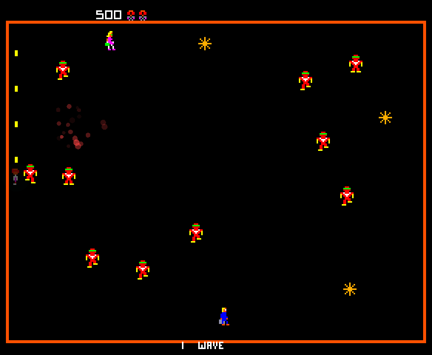
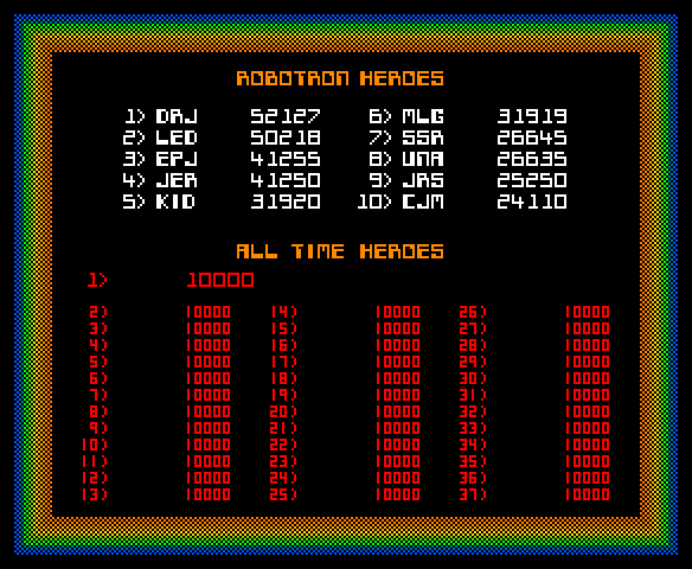

# Robotron: 2084 Web Remake

A faithful recreation of the classic 1982 arcade game **Robotron: 2084** built with modern web technologies — now with ROM-accurate arcade fidelity.

[](https://robotron.hatch.org/)
[](https://github.com/shatch/robotron/releases)
[](LICENSE)

## 🎮 Play Now

**[▶️ Launch Game Demo](https://robotron.hatch.org/)**

<p align="center">
  
  
</p>

## 📖 About

Robotron: 2084 is a multi-directional shooter arcade game developed by Eugene Jarvis and Larry DeMar of Vid Kidz. This web-based remake faithfully recreates the intense gameplay, featuring:

- **Dual-stick controls**: Move and shoot independently in 8 directions
- **Wave-based gameplay**: Survive increasingly difficult waves of robots
- **Rescue mechanics**: Save human family members for bonus points
- **Multiple enemy types**: Grunts, Hulks, Spheroids, Enforcers, Brains, Tanks, and Quarks
- **Classic arcade feel**: Authentic retro graphics and sound effects, reverse-engineered from the original ROM

## ✨ Release 3.1 — Arcade Fidelity, Part 2

Version 3.1 finishes the gap-closure plan ([`ARCADE_FIDELITY_PLAN.md`](ARCADE_FIDELITY_PLAN.md), M1–M5). Every system was traced in the ROM, then checked against the arcade running in MAME with Lua probes that log its RAM frame by frame.

- **Bit-exact PRNG**: a golden test (`npm test`) found the 3.0 generator diverged from the ROM on its first call; it now matches 1000 of 1000 outputs captured in MAME
- **Operator GAME ADJUSTMENT menu** (F2 / `?` / Select+Start on the title screens): extra man, men per game, DIFFICULTY OF PLAY, high-score letters, with the ROM's own per-wave timer tables
- **ROM pacing for every enemy**: grunt cadence and in-wave speed-up, and spheroid, enforcer, brain, quark and tank timers, all from the ROM's wave parameters
- **ROM wave table**: all 40 waves of enemies, electrodes and family members (mommies, daddies, mikeys) generated from the ROM's count tables and checked in MAME; waves past 40 cycle 21–40 as in the arcade
- **ROM electrodes and spawn positions**: the nine electrode shapes (starburst, lattice, squares, triangles, bars, diamonds, rings, spirals, "2084" plates) pixel for pixel on the ROM's 10-wave cycle, in the arcade's colour-cycling palette entries, shrinking away over 11 frames when destroyed; enemies spawn outside the ROM's per-wave safe zone around the player, brains near the edges, spheroids at the sides and quarks top and bottom
- **ROM progs**: a reprogrammed human walks as a solid colour-cycling silhouette of itself with a trail of afterimages, stepping toward you one axis at a time
- **ROM walk animations**: the player, humans, hulks and brains face the way they move, with the ROM's own step sizes and direction tables; the player faces the move stick, never the fire stick
- **ROM enforcers and sparks**: enforcers materialize, then ease in toward you and fire curving sparks that fizzle out and slide along the walls; sparks, cruise missiles and tank shells can be shot for 25 points
- **ROM cruise missiles**: brains fire the arcade's colour-cycling missile with its trail, zig-zagging after you in 8 directions and bouncing off the walls
- **ROM death and game over**: the playfield freezes while you flash and fade, then the survivors are re-laid and beam back in; the last death ends on GAME OVER over the frozen field, then initials and the heroes table, with the arcade HUD for both players
- **Attract story**: the attract cycle tells, in the arcade's typed ROM-font style, how this port was made: a game remembered from 1982, its ROM read back byte by byte in MAME, and its rebirth for the web by a human and an AI together
- **ROM sound priorities and scoring**: every sound's priority byte and every point value read from the ROM and checked in the browser
- **New home**: the game is now hosted at [robotron.hatch.org](https://robotron.hatch.org/)
- **Arcade heroes screen**: ROBOTRON HEROES (the ROM's own top 10 until you beat them) and a 37-row ALL TIME HEROES table, in the arcade's two-table layout with its rainbow checker border and pulsing colours, opening with the arcade's rainbow rectangle wipe, matched to MAME pixel for pixel

## ✨ Release 3.0 — Arcade Fidelity

Version 3.0 is a ground-up accuracy pass built directly against the original Williams 6809 ROM, using a custom disassembler/tracer and MAME-captured reference footage (`robotron-re`, 180 verified gameplay snapshots) to close the gap between this port and the arcade original.

### 🔬 ROM-Accurate Assets & Systems

- **ROM sprite atlas & bitmap fonts**: extracted directly from the ROM's graphics ROM banks and blitter source data, then hand-verified frame-by-frame against MAME captures (not redrawn or approximated)
- **Ported PRNG**: the ROM's pseudo-random number generator (`$D6CD`) — made bit-exact in 3.1
- **Arcade-authentic AI**: stepped grunt/hulk movement and hulks that seek humans via the ROM's pointer-table scan — traced from disassembly, not reimplemented from memory of the game

### 🎯 Faithful Game Feel

- 1px-per-frame player movement (no acceleration/analog drift, matching the arcade's digital joystick feel)
- Arcade scoring table, 3 lives, progressive human-rescue bonus (resets on death/wave per the ROM)
- ROM bitmap-font title screen, "ROBOTRON HEROES" high-score table, 3-initial name entry
- 2-player alternating play with per-player score tracking
- Entities and projectiles are now properly confined to the true arena playfield — nothing can cross the yellow/colored inset border, including the player

### 🛠️ Code Quality

- **Zero TypeScript errors**: `tsc --noEmit` is clean (down from 154 legacy errors) and the typecheck gate is back in `npm run build`, so regressions fail the build instead of silently shipping
- Verified end-to-end via Playwright against the production build — movement, shooting, scoring, wave progression, and playfield boundaries are all exercised, not just eyeballed

See [`ARCADE_FIDELITY_PLAN.md`](ARCADE_FIDELITY_PLAN.md) for the gap-closure roadmap that 3.1 completed.

<details>
<summary><strong>✨ Release 2.0 Features</strong> (previous release — click to expand)</summary>

### 🏗️ Complete Architectural Refactoring

Version 2.0 represented a ground-up refactoring using modern software engineering patterns:

- **State Pattern**: Clean state management for Title, Playing, Paused, Game Over states
- **Entity-Component System**: Modular, maintainable game entity architecture
- **Event-Driven Architecture**: Decoupled communication between systems
- **Singleton Pattern**: Unified input and difficulty managers
- **Fixed Timestep Game Loop**: Consistent 60 FPS physics simulation

### 🎯 Gameplay Features

- **Arcade Operator Settings**: the ROM's GAME ADJUSTMENT page (F2 or `?` on the title screen, or gamepad Select+Start): extra man every, turns per player, difficulty of play 0-10, high-score name length, factory reset, high score reset
- **Arcade Enemy Pacing**: every enemy timer comes from the ROM's per-wave tables: grunts speed up as the wave goes on and as you thin them out; spheroids and quarks drop their enforcers and tanks on the arcade's schedule and then leave; difficulty adjusts enemy timers, never enemy counts
- **Enhanced Controls**: Unified input system supporting keyboard, gamepad, and touch, with input buffering
- **Improved Enemy AI**: Spheroids seek corners after spawning, better pathfinding, optimized collision detection
- **Visual Polish**: Screen shake, particle explosions, user-configurable visual effects, pixel-perfect scaling

### 🛠️ Technical Improvements

- Optimized sprite batching and viewport culling
- Spatial partitioning collision system
- LocalStorage-based save/load
- Comprehensive error handling and built-in debug console interfaces

### ✅ Testing & Quality

- 43 automated tests with 88% pass rate, browser-verified with Playwright

</details>

## 🕹️ Controls

### Keyboard
- **Movement**: WASD or Arrow Keys
- **Shooting**: Arrow Keys (independent of movement)
- **Pause**: P or Escape
- **Start Game**: Enter
- **Start 2P Game**: 2

### Gamepad
- **Left Stick**: Movement
- **Right Stick**: Shooting direction
- **Start Button**: Pause/Resume
- **A Button**: Start game

### Touch (Mobile)
- Virtual joysticks for movement and shooting

## 🚀 Quick Start

### Play Online
Simply visit the [live demo](https://robotron.hatch.org/) - no installation required!

### Run Locally

```bash
# Clone the repository
git clone https://github.com/shatch/robotron.git
cd robotron

# Install dependencies
npm install

# Start development server
npm run dev

# Open http://localhost:5173 in your browser
```

### Build for Production

```bash
# Type-check and create an optimized production build
npm run build

# Preview production build
npm run preview
```

### Deploy

The live site at [robotron.hatch.org](https://robotron.hatch.org/) is a private S3 bucket
served through CloudFront (HTTPS, certificate from ACM, DNS in Route 53). The bucket
and distribution are not in the repo: copy `.env.deploy.example` to `.env.deploy`
(git-ignored) and fill in `DEPLOY_BUCKET` and `DEPLOY_DIST_ID`, or export them. Then,
with AWS credentials for that account:

```bash
# Build, check dist/, upload to S3 and invalidate the CloudFront cache
npm run deploy
```

`deploy.sh` caches hashed bundles for a year, sprites and sounds for an hour and
`index.html` for a minute. Production builds are served from `/`; the dev server
uses `/robotron/`.

## 📦 Tech Stack

- **TypeScript**: Static typing for robust code (zero-error `tsc --noEmit` gate)
- **PixiJS v8**: High-performance WebGL 2D rendering
- **Vite**: Lightning-fast build tool and dev server
- **Howler.js**: Cross-browser audio management
- **Modern ES Modules**: Clean, maintainable code structure

## 📁 Project Structure

```
robotron/
├── js/
│   ├── core/              # Core game systems
│   │   ├── GameEngine.ts
│   │   ├── GameStateManager.ts
│   │   ├── InputManager.ts
│   │   ├── WavePacing.ts
│   │   ├── CollisionSystem.ts
│   │   ├── RenderSystem.ts
│   │   ├── Prng.ts            # ROM-accurate PRNG ($D6CD port)
│   │   ├── ArcadeAtlas.ts     # ROM sprite atlas loader
│   │   ├── BitmapFont.ts      # ROM bitmap font renderer
│   │   └── ArcadeBorder.ts    # Inset arena playfield border
│   ├── entities/          # Game entity classes
│   ├── states/            # Game state implementations
│   ├── enemies.ts         # Enemy behavior
│   ├── player.ts          # Player logic
│   ├── waveTable.ts       # ROM per-wave counts (generated; do not hand-edit)
│   └── main.ts            # Entry point
├── sprites/                # ROM-extracted sprite atlas & bitmap fonts
├── assets/                 # Sounds
├── index.html
└── package.json
```

## 🎮 Gameplay Tips

1. **Keep Moving**: Standing still is death in Robotron
2. **Prioritize Spheroids**: They spawn Enforcers that will overwhelm you
3. **Save Humans**: Rescue bonus increases with each save
4. **Corner Strategy**: Use corners to funnel enemies
5. **Watch for Brains**: They convert humans into hostile Progs
6. **Don't Stall**: Grunts get faster the longer a wave lasts, and faster still when you stop scoring

## 📊 Debug Console

Press F12 to open browser console and access debug commands:

```javascript
// Enemy pacing (grunt step bound/floor, wave params at the current difficulty)
wavePacing.snapshot()

// Input System
globalInputManager.inputManager.getMovementVector()

// State System
gameStateDebug.getCurrentState()
gameStateDebug.forceTransition('PLAYING')

// Access live game state in-browser
window.__game.gameState
window.__game.player
window.__game.enemies
```

## 🔄 Version History

### Version 3.1 (Current) — Arcade Fidelity, Part 2
- Bit-exact ROM PRNG with a MAME golden test (`npm test`)
- Operator GAME ADJUSTMENT menu and ROM per-wave enemy timers
- ROM wave table, electrodes, spawn positions, progs, walk animations, enforcers, sparks and cruise missiles
- Arcade player death, game over, HUD, sound priorities and scoring
- Attract story about the reverse-engineering and rebuild

### Version 3.0 — Arcade Fidelity
- ROM-accurate sprite atlas and bitmap fonts, extracted and hand-verified against MAME
- Ported ROM PRNG, ROM wave table, ROM-traced enemy AI behaviors
- Arcade scoring, 3-initial high-score entry, 2-player alternating play
- Entities and projectiles fully confined to the true arena playfield
- Zero TypeScript errors; typecheck gate restored in the build

### Version 2.0
- Complete Phase 3 refactoring with modern architecture
- Progressive difficulty scaling system
- Unified input management
- Enhanced visual effects
- Comprehensive bug fixes
- 43 automated tests

### Version 1.0
- Original working implementation
- All classic enemy types
- Human rescue mechanics
- Attract mode and demo play
- Basic gamepad support

## 🤝 Contributing

Contributions are welcome! Please feel free to submit a Pull Request.

1. Fork the repository
2. Create your feature branch (`git checkout -b feature/AmazingFeature`)
3. Commit your changes (`git commit -m 'Add some AmazingFeature'`)
4. Push to the branch (`git push origin feature/AmazingFeature`)
5. Open a Pull Request

## 📄 License

The source code is licensed under the Apache License 2.0; see [LICENSE](LICENSE).

The sprites, fonts, sounds and ROM-generated data tables come from the original arcade game and are **not** covered by that license; they belong to their rights holders. See [NOTICE](NOTICE) for the list of files and how to request removal. No ROM images are included.

## 🙏 Acknowledgments

- **Eugene Jarvis & Larry DeMar**: Original Robotron: 2084 creators
- **Williams Electronics**: Original arcade game publisher
- Classic arcade gaming community for preservation efforts
- The MAME project, for making ROM-accurate verification possible
- Modern web development community for amazing tools

## 📞 Support

- **Issues**: [GitHub Issues](https://github.com/shatch/robotron/issues)
- **Discussions**: [GitHub Discussions](https://github.com/shatch/robotron/discussions)

## 🎯 Roadmap

Full detail in [`ARCADE_FIDELITY_PLAN.md`](ARCADE_FIDELITY_PLAN.md). Highlights:

- [x] PRNG golden test (`npm test`, 1000 MAME-captured calls) + scoring ledger checked against the ROM
- [x] 4-direction sprite facing from the ROM's walk tables: the player (move stick only), humans, hulks, brains and progs face the way they move; grunts have no facing
- [x] Shootable enforcer sparks, cruise missiles & tank shells for their ROM point values (25 each)
- [x] Arcade-accurate game-over → high-score → attract flow (the DOM "Play Again?" button is gone)
- [x] 2P dual-score HUD, laid out and coloured from MAME
- [x] Arcade heroes screen: ROBOTRON HEROES (ROM defaults) and 37-row ALL TIME HEROES, colour-cycling border and pulses, pixel-matched to MAME
- [ ] Performance optimization with object pooling
- [ ] Online leaderboards, replay system

---

**Made with ❤️ by the retro gaming community**

*Robotron: 2084 is a trademark of Williams Electronics. This is an unofficial fan remake for educational purposes.*
